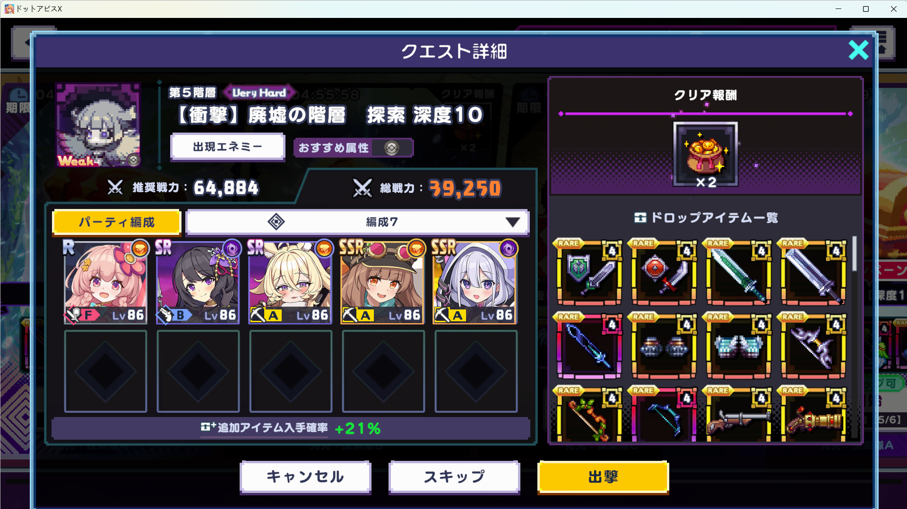

# 刷绿衣前必看

## 开刷前的配置

1. 游戏停在**第 5 层 Very Hard「【衝撃】廃墟の階層／探索 深度 10」任务详情页**，画面下方能看到黄色「出撃」按钮。右侧掉落列表里应有绿色衣服图标（森林披风）。不要从关卡列表、普通战斗中途或其他宝箱关启动。
2. 按此前实测调整队伍：不开 AUTO 时，未出绿衣的一局要能够自然战败，以便脚本点「再挑战」；出绿衣后如果选择 AUTO 通关，队伍也要能撑到胜利。队伍血量或装备变化会改变战败时间，请先观察一局。不要用会自行通关的过厚队伍，否则会消耗每日有限的通关次数。
3. 固定游戏窗口大小和位置，运行时保持游戏在前台。启动后有 8 秒切回游戏。其他窗口遮住游戏、切换分辨率或窗口尺寸，都可能使识别停下。F12 停止；鼠标移到屏幕角落可紧急停止。
4. 双击项目的 `启动脚本.cmd`，选择「绿衣」页。这里的重试次数、每局时限和检出后行为保存在 `green_farm_settings.json`，不会改动深渊页的 `config.json`。
5. 检出后可选「暂停，保留战利品界面」（默认）或「打开 AUTO，等到胜利结算后停止」。后一分支尚未用真实绿衣掉落实机验证；首次使用请在旁边看着，确认 AUTO 已亮、胜利页停住。

## 起始界面示例

应与示例一样停在任务详情页，任务名包含「探索 深度 10」，下方黄色「出撃」可点击。截图中的编队和战力只是当时的示例，不要求数字完全一致；关键是选中正确任务，并让队伍符合上面的战败与通关条件。

## 开始后的预期流程

脚本出击后先确认并关闭 AUTO。第一波小怪自然掉东西就直接打开右上角宝箱检查；若等一会仍无掉落，则等能量达到 4 点，点右下第二个水晶 FC 一次，确认放出后再看战利品。掉落数量多没关系，会检查整个可见列表。确认没有绿衣时关闭战利品，停止主动施放 FC，等待战败后「再挑战」。有绿衣时按绿衣页选项暂停，或开启 AUTO 等胜利；**胜利结算界面不会自动点击**。

识别不确定、窗口尺寸变化、FC 未验证或超时会停止并保留截图，不会盲目继续。日志与截图在 `runs/green_farm/` 最新时间目录；绿衣页有「打开日志」按钮。
